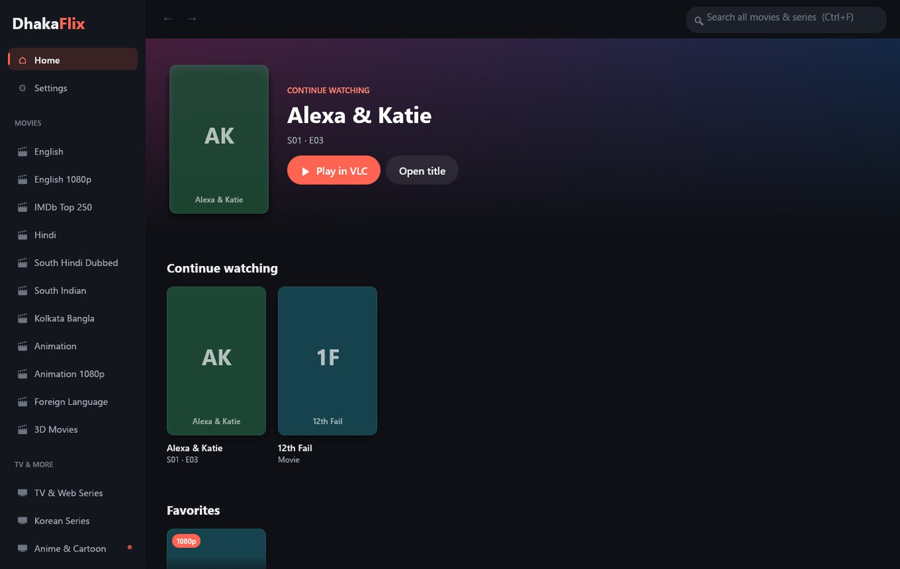
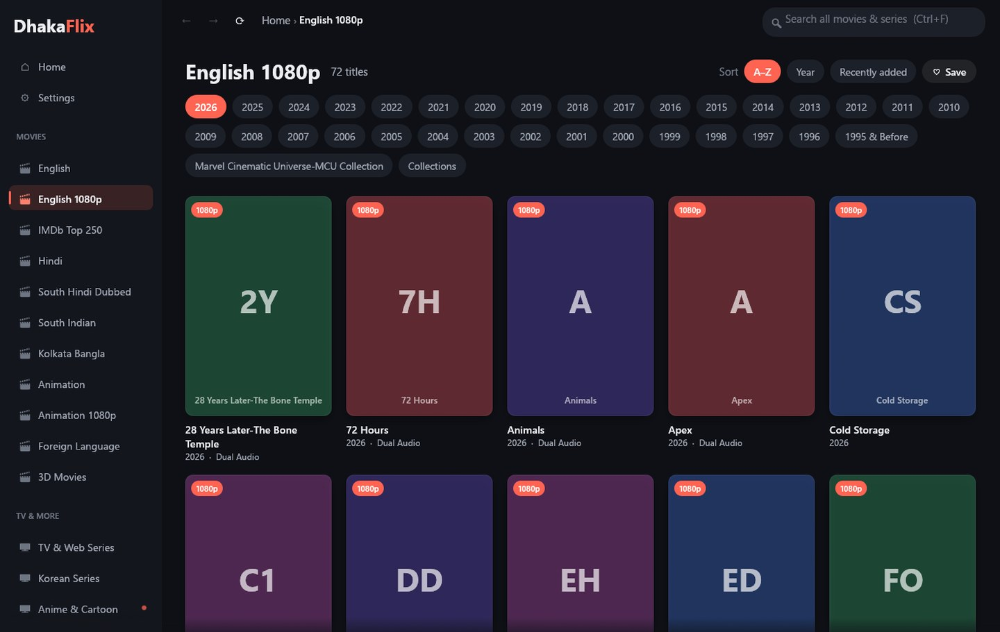
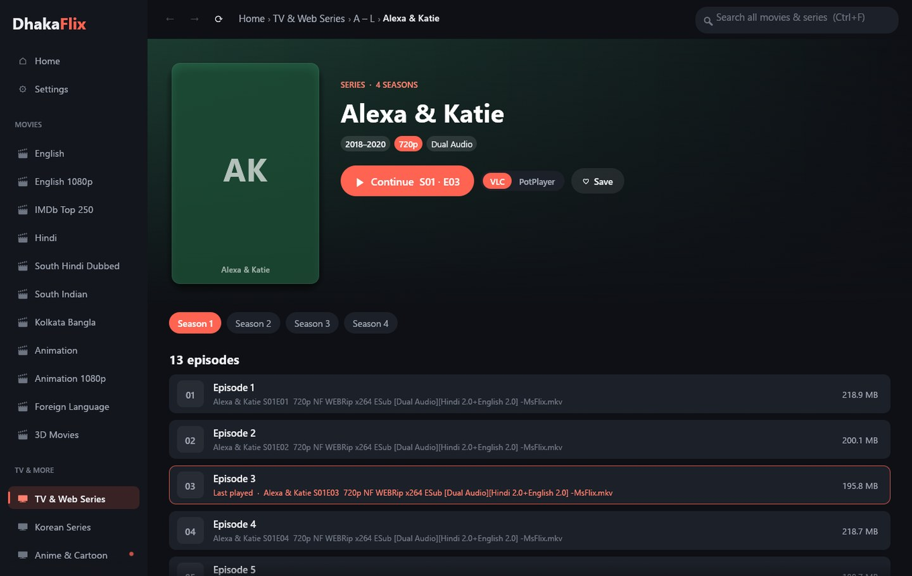
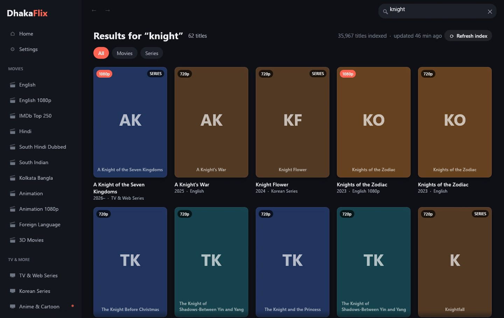
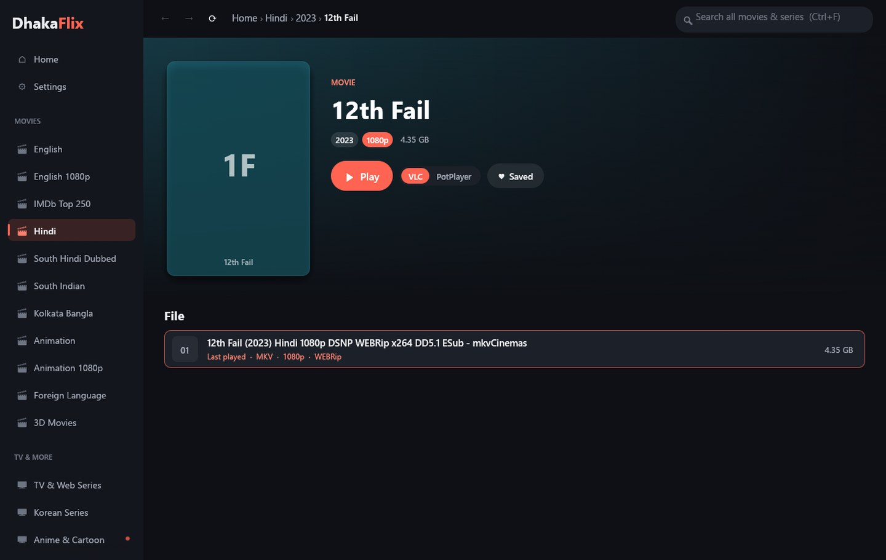

# DhakaFlix Player

**An unofficial Windows desktop app for browsing the DhakaFlix media servers and streaming
straight to VLC or PotPlayer.** It turns the plain folder listings into a poster browser: year
tabs, title pages, season and episode lists, and a search across every library at once.



> [!IMPORTANT]
> **This only works on a DhakaFlix network.** The servers (`172.16.50.x`) are private LAN
> addresses that are reachable only from inside an ISP that provides DhakaFlix, or one of its
> partner ISPs. On any other connection the app opens, but every library shows as offline.
>
> This project is **not affiliated with, endorsed by, or connected to DhakaFlix** or any ISP.
> It hosts, copies and redistributes no media. See [Disclaimer](#disclaimer).

## Features

| | |
|---|---|
| **Poster browser** | Every library as a grid of covers with quality (1080p / 720p), IMDb rank and series badges. Year and A to Z folders become tabs. |
| **Title pages** | Blurred backdrop, poster, year, tags, file size and one big Play button. |
| **Series** | Season tabs and an episode list. Playing an episode queues the rest of the season, so the player moves on by itself. "Continue S01 E03" remembers where you were. |
| **Search everything** | About 36,000 titles across all libraries, instant from the first launch. Filter by Movies or Series, or by the library you came from. |
| **Your player** | VLC, PotPlayer or any other player (mpv, MPC-HC) with custom arguments. Streams play over HTTP with full seeking; nothing is downloaded first. |
| **Home** | Continue watching, favorites and a tile for every library showing whether its server is online. |

<table>
<tr>
<td></td>
<td></td>
</tr>
<tr>
<td></td>
<td></td>
</tr>
</table>

The screenshots use placeholder covers. In the app you see the posters that the DhakaFlix
servers provide.

## Install

1. Download `DhakaFlix.exe` from the [latest release](https://github.com/shabab239/DhakaFlix/releases/latest).
2. Run it. There is no installer, and it needs no admin rights.
3. Have [VLC](https://www.videolan.org/) or [PotPlayer](https://potplayer.daum.net/) installed.
   The app finds them in their usual folders; otherwise set the path in **Settings**.

Windows 10 or 11, 64-bit. Windows SmartScreen may warn about an unsigned app the first
time; choose **More info**, then **Run anyway**.

## Using it

- **Browse:** pick a library on the left, choose a year tab, click a poster.
- **Play:** the big Play button on a title page, or click any episode or file. Right-click
  for "Play in VLC / PotPlayer", "Play only this file" and "Copy link".
- **Search:** Ctrl+F, then type. Every word must match the title, year, quality, tags or
  library, so `batman 2022` or `dual audio 2023` work.
- **Navigate:** Back and Forward buttons, Alt+Left / Alt+Right, or the mouse side buttons.
- **Favorites:** "Save" on a title page or a library, or right-click a poster.

The search index ships inside the exe, so search works straight away. On the first search
of a session the app refreshes it in the background if it is more than a day old, and
**Refresh index** on the results page forces it.

## Where it keeps data

| What | Where |
|---|---|
| Settings, favorites, history | `%APPDATA%\dhakaflix-player\config.json` |
| Search index, poster cache, playlists | `%LOCALAPPDATA%\dhakaflix-player\` |

Delete those folders to reset the app. The poster cache can also be cleared in Settings.

## Building from source

Rust (stable). On the MSVC toolchain `cargo build --release` is enough.

On the GNU toolchain (`x86_64-pc-windows-gnu`) you also need MinGW binutils (`dlltool`,
`windres`) on `PATH`, for example WinLibs:

```powershell
winget install BrechtSanders.WinLibs.POSIX.UCRT
.\build.ps1            # tests + release build
.\build.ps1 -Desktop   # also copies DhakaFlix.exe to the Desktop
```

`cargo test` runs the offline tests. `cargo test -- --ignored` adds tests that talk to the
live servers, so they only pass on a DhakaFlix network.

| File | What it does |
|---|---|
| `src/scrape.rs` | Reads the servers' h5ai directory listings |
| `src/meta.rs` | Turns folder names into title, year, quality and tags |
| `src/covers.rs` | Background loader, poster thumbnails and disk cache |
| `src/index.rs` | Library-wide crawl and search |
| `src/views.rs` | Pages: home, library, title, search, settings |
| `src/player.rs` | Finds and launches VLC / PotPlayer / custom players |
| `assets/make_icon.py` | Draws the app icon (`uv run --with pillow python assets/make_icon.py assets`) |

Updating the bundled index: run the app on a DhakaFlix network, let a refresh finish, then
gzip `%LOCALAPPDATA%\dhakaflix-player\index.json` into `assets/default_index.json.gz` and rebuild.

## Disclaimer

- DhakaFlix Player is an independent, unofficial client. "DhakaFlix" is used only to say
  which servers it works with. It is not affiliated with, endorsed by or connected to
  DhakaFlix, its operators, or any internet service provider.
- The app hosts, stores, copies and redistributes no media. It reads the directory listings
  that the servers publish to their own users and passes stream links to a media player you
  installed yourself, exactly as opening those links in a browser would.
- All movies, series, posters and other artwork belong to their respective owners. The
  bundled search index contains only folder names and links as published by the servers.
- Access to the servers is provided by your ISP under its own terms. Use the app only where
  you are allowed to use those servers, and follow your ISP's terms.
- If you represent DhakaFlix or a rights holder and want something changed, please open an
  issue.

## License

The source code is under the [MIT License](LICENSE). Third-party components and their
licenses are listed in [THIRD-PARTY-NOTICES.md](THIRD-PARTY-NOTICES.md).
